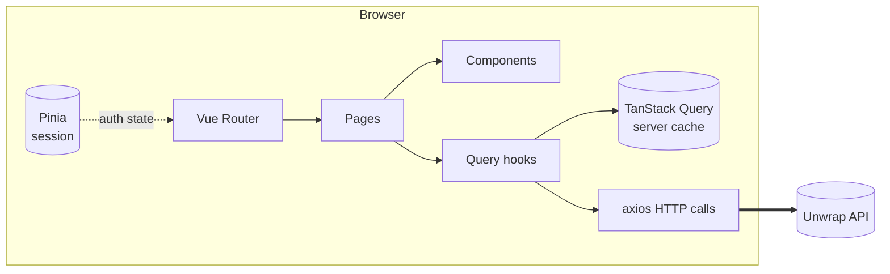

# Unwrap — Frontend

SPA for exploring your listening history across Spotify and Last.fm. Unwrap unifies the same recording across both providers and provides ranked statistics such as top tracks, top artists and total listening time, including user made exclusions of tracks or artists.

---

## Tech Stack

**Framework and language**: Vue 3, TypeScript, Vite

**State and data fetching**: Pinia, TanStack Vue Query, Axios

**Routing and UI**: Vue Router, Tailwind CSS

**Testing and mocking**: Vitest, Mock Service Worker (msw)

## Architecture diagram



---

## Getting Started

### Prerequisites

- [Bun](https://bun.sh/)
- The Unwrap backend running, or `VITE_USE_MOCKS=true` to run without it

### Install

```bash
bun install
```

### Configure

Create `.env.local`:

```env
VITE_API_URL=http://localhost:8080
VITE_USE_MOCKS=true   #serve mocked responses, no backend needed
```

### Run

```bash
bun run dev
```

### Build & preview

```bash
bun run build
bun run preview
```

### Test

```bash
bun run test
```

---

## Project Layout

```
src/
├── components/      # reusable UI
├── composables/     # query hooks
├── pages/           # route-level views
├── router/          # routes
├── services/        # api.ts (axios)
├── stores/          # Pinia (auth)
└── mocks/           # MSW
```
